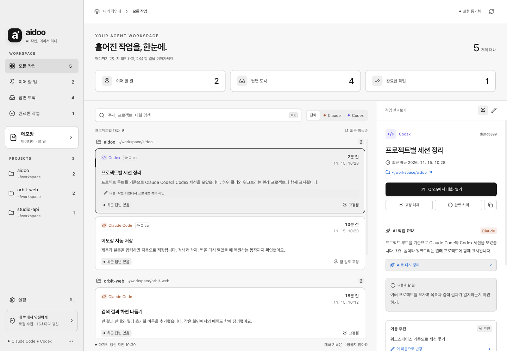
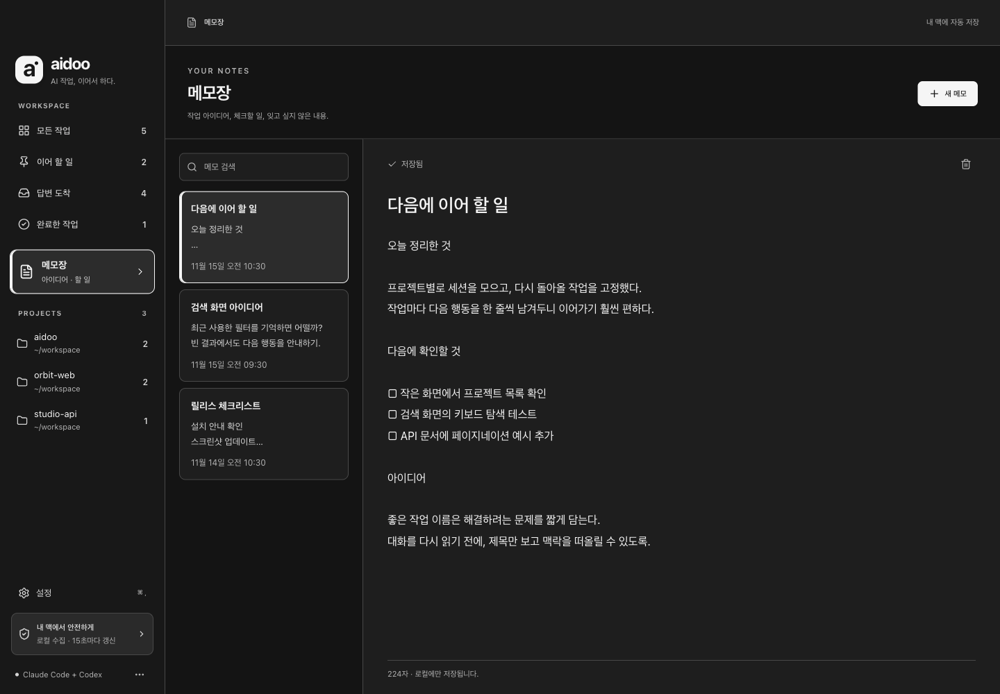
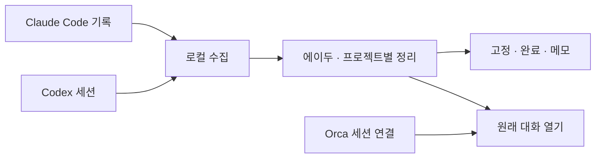

<p align="center">
  <picture>
    <source media="(prefers-color-scheme: dark)" srcset="assets/logo-dark.svg">
    
  </picture>
</p>

<h3 align="center">흩어진 AI 작업을, 이어서.</h3>

<p align="center">
  Claude Code와 Codex 대화를 프로젝트별로 모으고,<br>
  어디까지 했는지 확인하고, 다음 할 일을 이어가세요.
</p>

<p align="center">
  <a href="README.md">English</a> · 한국어
</p>

<p align="center">
  
  
  
  <a href="LICENSE"></a>
</p>

<p align="center">
  <a href="#주요-기능">주요 기능</a> · <a href="#시작하기">시작하기</a> · <a href="#동작-방식">동작 방식</a> · <a href="#개발과-기여">개발과 기여</a>
</p>

<p align="center">
  <picture>
    <source media="(prefers-color-scheme: dark)" srcset="assets/screenshots/workspace-dark.png">
    
  </picture>
</p>
<p align="center"><sub>예시 데이터를 넣은 실제 앱 화면입니다. 현재 앱 UI는 한국어를 지원합니다.</sub></p>

---

Claude Code 몇 개, Codex 몇 개. Orca에서도 쓰고, 터미널에서도 쓰다 보면 어느 대화에서 무슨 작업을 했는지부터 헷갈립니다. 다른 프로젝트를 잠깐 보고 돌아오면, 다음에 뭘 하려던 건지 다시 읽어봐야 하고요.

**에이두**는 그 맥락을 모아두는 작은 작업대입니다. 맥에 이미 있는 대화를 프로젝트별로 정리하고, 다시 돌아올 작업을 고정합니다. 다음 행동을 한 줄 남기고, 알아보기 쉬운 이름을 붙이고, 준비되면 원래 대화로 돌아가세요.

## 주요 기능

- **익숙한 프로젝트 단위로.**<br>
  프로젝트가 들어 있는 상위 폴더를 선택하세요. `my-app/src`와 `my-app/tests`, Git 워크트리의 대화도 원래 프로젝트로 묶습니다. 제목, 대화 발췌, 요약, 개인 메모를 함께 검색할 수 있습니다.

- **대화마다 다음 할 일을.**<br>
  최근 요청과 답변을 확인하고, 이어 할 일을 고정하거나 완료 처리하세요. 고정한 작업은 목록 맨 위에 모이며, 설정에서 끌 수 있습니다. 설정에서 켜면 완료 처리할 때 그 대화의 Orca 탭도 닫습니다. 상대 시간과 정확한 날짜·시각을 함께 보여주며, 15초마다 목록을 갱신합니다.

- **원래 대화로 돌아가기.**<br>
  연결된 Orca 터미널이 있으면 해당 탭을 엽니다. 다른 세션은 macOS Terminal에서 같은 세션 ID로 재개합니다. 재개 명령을 복사해 원하는 터미널에서 사용할 수도 있습니다.

- **제목만 봐도 떠오르는 맥락.**<br>
  추천 이름을 적용하거나 직접 이름을 붙이세요. Claude Code·Codex 원본 세션과 연결된 Orca 탭까지 함께 변경할 수 있습니다. 동기화를 끄면 에이두 안에서만 이름을 바꿉니다.

- **필요할 때 요청하는 AI 요약.**<br>
  로그인된 Claude Code로 작업 요약, 다음 행동, 추천 이름을 만듭니다. 최근 대화를 보내기 전에 화면에서 확인하며, 기본 목록과 로컬 발췌는 모델을 호출하지 않습니다.

- **작업 옆에 두는 메모장.**<br>
  특정 세션과 관계없는 아이디어나 체크리스트도 적어두세요. 입력할 때 자동 저장하고 제목과 내용을 검색할 수 있습니다. 작업별 메모는 해당 대화에 따로 남길 수 있어요.

  <p></p>

- **맥에 켜두기 편하게.**<br>
  흑백 테마에 라이트·다크·시스템 모드를 지원합니다. 창을 닫아도 메뉴바에 남습니다. 별도 서버나 Python 런타임을 설치할 필요가 없습니다.

## 시작하기

**Node.js 22.12 이상**과 npm으로 소스에서 빌드합니다. **macOS Apple Silicon**에서 개발·검증하고 있습니다. 목록에 표시할 Claude Code 또는 Codex의 로컬 세션이 필요하며, Orca 연동은 선택 사항입니다.

```sh
git clone https://github.com/YoonShinWoong/aidoo.git
cd aidoo
npm ci --include=optional
npm run package
open release/mac-arm64/Aidoo.app
```

생성된 `Aidoo.app`을 응용 프로그램 폴더로 옮겨 사용할 수 있습니다. 현재 빌드는 Apple 개발자 서명·공증이 적용되지 않았습니다.

처음 실행하면:

1. **설정**(`⌘,`)에서 프로젝트가 들어 있는 상위 폴더를 지정하세요. 기본값은 `~/workspace`입니다.
2. 대화를 선택해 최근 맥락을 확인하고, 다시 돌아올 작업을 고정하세요.
3. Orca나 Terminal에서 대화를 이어가거나, 다음에 볼 메모를 남기세요.

| 단축키 | 동작 |
|---|---|
| `⌘K` | 세션 검색창으로 이동 |
| `⌘R` | 세션 새로고침 |
| `⌘,` | 설정 열기 |

창을 닫아도 앱은 계속 실행됩니다. 완전히 종료하려면 앱 메뉴에서 **에이두 종료**를 선택하세요.

## 동작 방식



Orca는 별도의 대화 엔진으로 중복 표시하지 않습니다. 기존 Claude Code·Codex 세션을 찾아 돌아가는 연결 역할을 합니다.

| 연결 대상 | 읽는 정보 | 대화 열기 | 이름 변경 |
|---|---|---|---|
| Claude Code | 로컬 JSONL 대화 기록 | Terminal의 `claude --resume` 또는 연결된 Orca 탭 | 공식 Agent SDK |
| Codex | 로컬 SQLite 인덱스와 rollout 기록 | Terminal의 `codex resume` 또는 연결된 Orca 탭 | App Server `thread/name/set` |
| Orca | 로컬 프로필과 터미널 정보 | 연결된 터미널로 이동 | CLI `terminal rename` |

### 데이터는 어디에 있나요?

수집은 원본 대화와 DB를 읽기만 합니다. 이름 변경을 적용하면 위 연동을 통해 세션 이름을 수정하며, 모델을 호출하거나 대화를 재개하지 않습니다. 메모·작업 상태·설정은 맥에 저장합니다. 텔레메트리는 없습니다.

| `~/Library/Application Support/Aidoo/`의 파일 | 저장 내용 |
|---|---|
| `session-state.json` | 고정, 완료 상태, 작업별 메모, 표시 이름, 요청한 AI 요약 |
| `notes.json` | 독립 메모장 내용 |
| `settings.json` | 테마와 프로젝트 상위 폴더 |

대화 원문을 별도의 파일로 복제하지 않습니다. AI 요약을 요청하면 확인 후 최근 메시지 최대 12개를 기존 Claude Code 로그인을 통해 전송하고, 해당 계정의 사용 한도를 사용합니다. 생성한 요약은 로컬에 저장합니다.

### 현재 지원 범위

- **작업 상태는 실행 정보와 기록으로 판단합니다.** Claude Code는 실행 중인 세션이 남기는 상태 파일로, Codex는 기록의 작업 시작과 완료 이벤트로 작업 중과 답변 도착을 구분합니다. Claude Code가 승인을 기다리면 답변 도착으로 보이고, Codex의 승인 대기는 따로 구분하지 않습니다.
- **수집량에 제한이 있습니다.** 최근 세션 최대 500개, 대화당 앞뒤 768 KiB까지 읽습니다. 긴 대화의 중간 부분은 생략될 수 있으며, subagent 기록은 독립 작업에서 제외합니다.
- **기존 앱 연결에는 범위가 있습니다.** Orca 터미널 연결을 지원합니다. 기존 Terminal·iTerm·IDE 탭 찾기, 원격 호스트 수집, Orca 네이티브 채팅 탭 연결은 지원하지 않습니다.
- **연동 형식은 바뀔 수 있습니다.** Orca의 비공개 저장 형식을 일부 참조합니다. 이미 열린 Claude Code·Codex 화면은 새로 열거나 재개해야 변경된 이름이 보일 수 있습니다. 이름 변경이 일부 실패하면 앱에서 알려줍니다.
- **현재는 macOS 앱입니다.** 자동 업데이트는 없습니다. Terminal 재개 시 macOS 자동화 권한을 요청할 수 있으며, 명령 복사는 권한 없이 사용할 수 있습니다.

<details>
<summary>수집 경로와 실행 격리 자세히 보기</summary>

Claude의 `~/.claude/projects/*/*.jsonl`과 Codex의 `state_*.sqlite` 및 rollout 파일을 읽습니다. `CLAUDE_CONFIG_DIR`, `CODEX_HOME`, Orca 관리 Codex 계정 홈도 탐색합니다. 변경되지 않은 기록은 메모리에 캐시하며, SQLite는 macOS 내장 `/usr/bin/sqlite3`로 읽기 전용 조회합니다.

Claude 이름 변경은 해당 세션의 설정 디렉토리를 지정한 별도 프로세스에서 실행하며, Codex는 해당 계정 홈을 사용합니다. 렌더러는 컨텍스트 격리와 샌드박스, 제한된 preload API를 사용합니다. 외부 웹페이지를 로드하거나 임의 파일·셸 접근 API를 화면에 노출하지 않습니다.

</details>

## 개발과 기여

```sh
npm run dev       # Electron + 화면 변경 실시간 반영
npm run build     # 타입 검사와 빌드
npm test          # 빌드 후 실행; 격리된 이름 변경 테스트 포함
npm run smoke     # 실제 로컬 세션 + 임시 앱 데이터로 UI 검증
```

UI 검증은 로컬 세션을 읽지만 원본 세션이나 Orca 탭 이름을 변경하지 않고, AI 요청도 보내지 않습니다. 패키징한 앱도 검증할 수 있습니다.

```sh
AIDOO_EXECUTABLE=/path/to/Aidoo.app/Contents/MacOS/Aidoo npm run smoke
```

README 스크린샷은 빌드 후 `npx tsx scripts/docs-screenshots.ts`로 다시 만들 수 있습니다. **예시 데이터만 사용하며 실제 대화를 수집하지 않습니다.** Electron 바이너리가 설치 중 내려받아지지 않았다면 `npx install-electron --no`를 실행하세요. `.tool-versions`는 Node.js 22.22.1을 지정합니다.

```text
src/main/       수집, 프로젝트 묶기, 외부 연동, 저장
src/preload/    앱과 화면 사이의 명시적 API
src/renderer/   React 작업대, 메모장, 설정
src/shared/     공통 TypeScript 타입
scripts/        UI 검증과 문서용 스크린샷 생성
tests/          파싱, 프로젝트 집계, 읽기 전용 접근, 격리된 이름 변경
```

버그 제보와 작은 단위의 PR을 환영합니다. 연동 문제는 앱·CLI 버전과 재현 방법을 함께 알려주세요. 스크린샷과 테스트에는 예시 데이터를 사용하고, 개인 대화·경로·인증 정보는 포함하지 마세요.

## 라이선스

[MIT](LICENSE). 의존 라이브러리에는 각 패키지의 라이선스가 적용됩니다.
