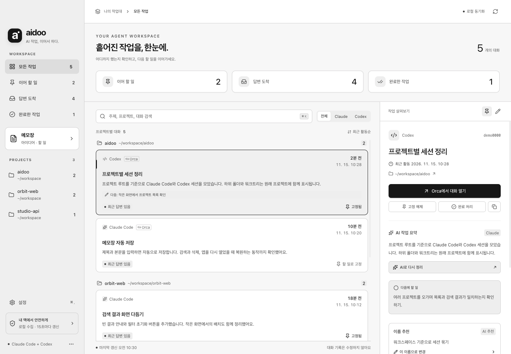
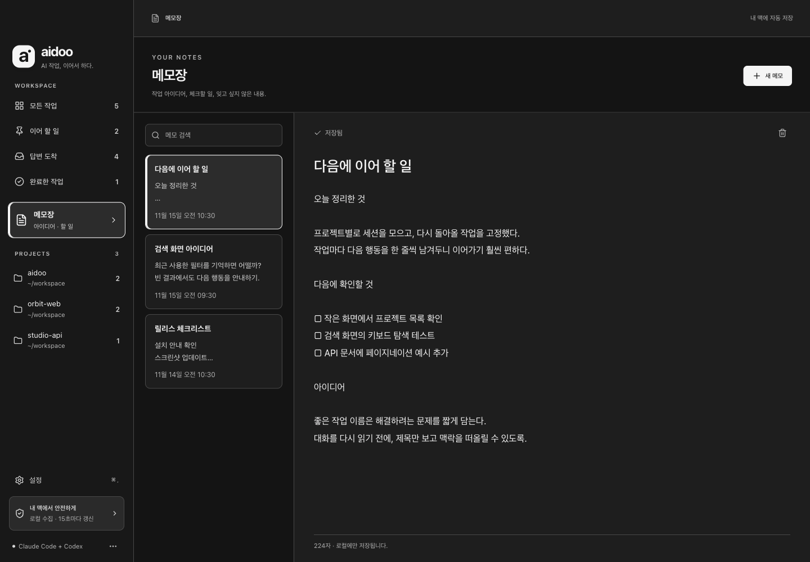
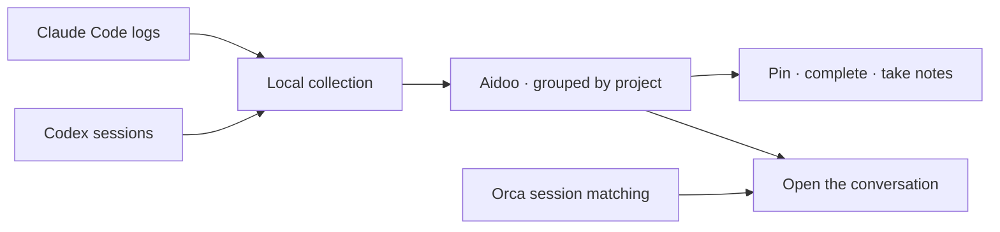

<p align="center">
  <picture>
    <source media="(prefers-color-scheme: dark)" srcset="assets/logo-dark.svg">
    
  </picture>
</p>

<h3 align="center">Pick up where your coding agents left off.</h3>

<p align="center">
  Claude Code and Codex sessions, grouped by project.<br>
  See the context. Keep the next step. Get back to work.
</p>

<p align="center">
  English · <a href="README.ko.md">한국어</a>
</p>

<p align="center">
  
  
  
  <a href="LICENSE"></a>
</p>

<p align="center">
  <a href="#highlights">Highlights</a> · <a href="#getting-started">Get started</a> · <a href="#how-it-works">How it works</a> · <a href="#development">Contribute</a>
</p>

<p align="center">
  <picture>
    <source media="(prefers-color-scheme: dark)" srcset="assets/screenshots/workspace-dark.png">
    
  </picture>
</p>
<p align="center"><sub>Actual app screens with fictional sample data. The app UI is currently in Korean.</sub></p>

---

A few Claude Code sessions. A few Codex sessions. Some open in Orca, some in a terminal. After switching projects a couple of times, the hard part is remembering which conversation mattered and what you were going to do next.

**Aidoo** is a small place to keep that context. It reads the conversations already on your Mac, groups them by project, and lets you pin the ones worth returning to. Leave yourself a note, give a session a useful name, and open it again when you're ready.

## Highlights

- **Projects you recognize.**<br>
  Choose your workspace folders. Sessions in nested directories and Git worktrees are grouped with their original project, so `my-app/src` and `my-app/tests` belong together. Search across titles, conversation excerpts, summaries, and your notes.

- **A next step for every conversation.**<br>
  Read the latest request and reply, pin a session to your follow-up list, or mark it done. Relative and exact timestamps help you find where you left off. The list refreshes every 15 seconds.

- **Back to the session.**<br>
  A matched Orca terminal opens in Orca. Other sessions resume by ID in macOS Terminal. You can also copy the resume command and use it in your preferred terminal.

- **Names that carry the context.**<br>
  Apply a suggested name or write your own. Aidoo can sync it to the original Claude Code or Codex session and its connected Orca tab. Turn sync off to keep the name in Aidoo only.

- **AI summaries when you ask for them.**<br>
  With Claude Code installed and signed in, request a summary, a next action, and a suggested title. Aidoo asks before sending recent conversation excerpts through Claude Code. Browsing and local excerpts require no model calls.

- **A notebook beside your work.**<br>
  Keep quick ideas, checklists, and reminders outside any particular session. Notes save as you type and are searchable. Session-specific notes stay with their task.

  <p></p>

- **At home on your Mac.**<br>
  A monochrome interface with light, dark, and system appearance. Close the window and Aidoo stays in the menu bar. No separate server or Python runtime to set up.

## Getting started

Build from source with **Node.js 22.12+** and npm. Aidoo is developed and tested on **macOS Apple Silicon**. You'll need local Claude Code or Codex sessions to populate the workspace; Orca is optional.

```sh
git clone https://github.com/YoonShinWoong/aidoo.git
cd aidoo
npm ci --include=optional
npm run package
open release/mac-arm64/Aidoo.app
```

You can move the resulting `Aidoo.app` into Applications. Current builds are not Apple-signed or notarized.

On first launch:

1. Open **Settings** (`⌘,`) and choose the parent folders that contain your projects. The default is `~/workspace`.
2. Pick a session to read its latest context. Pin the work you want to return to.
3. Open the conversation in Orca or Terminal, or leave a note for later.

| Shortcut | Action |
|---|---|
| `⌘K` | Focus session search |
| `⌘R` | Refresh sessions |
| `⌘,` | Open settings |

Closing the window keeps Aidoo running. Use **에이두 종료** in the app menu to quit.

## How it works



Orca is a way to reach an existing Claude Code or Codex session, rather than a third copy of the conversation.

| Source | Read | Open | Rename |
|---|---|---|---|
| Claude Code | Local JSONL transcripts | `claude --resume` in Terminal, or a matched Orca tab | Official Agent SDK |
| Codex | Local SQLite index and rollout logs | `codex resume` in Terminal, or a matched Orca tab | App Server `thread/name/set` |
| Orca | Local profile and terminal metadata | Switch to the matched terminal | CLI `terminal rename` |

### Your data

Collection reads the original logs and databases without changing them. Rename is an explicit action: it updates session names through the integrations above, without starting a model turn. Notes, task state, and settings stay on your Mac. There is no telemetry.

| File in `~/Library/Application Support/Aidoo/` | Contents |
|---|---|
| `session-state.json` | Pins, completion state, session notes, local titles, requested AI summaries |
| `notes.json` | Standalone notebook entries |
| `settings.json` | Appearance and workspace folders |

Conversation transcripts are not copied into a separate on-disk archive. Optional AI summaries send up to 12 recent messages through your existing Claude Code login, after confirmation, and use its usage allowance. The resulting summary is saved locally.

### Current scope

- **Activity comes from conversation history.** A recent reply is not proof that an agent is finished, running, or waiting for approval.
- **Collection is bounded.** Up to 500 recent sessions; up to 768 KiB from the beginning and end of each transcript. Long conversations can omit the middle. Subagent records are excluded as standalone work.
- **Opening a session has limits.** Orca terminal matching is supported; finding existing Terminal, iTerm, or IDE tabs is not. Remote hosts and Orca native chat tabs are not supported.
- **Integrations can change.** Orca matching uses some private storage formats. Already-open Claude Code or Codex screens may need a refresh or resume to show a renamed session. Partial rename failures are reported in the app.
- **macOS only for now.** No automatic updates. Terminal resume may request macOS Automation permission; copying the command does not require it.

<details>
<summary>Collection paths and isolation</summary>

Claude records come from `~/.claude/projects/*/*.jsonl`. Codex records come from `state_*.sqlite` and rollout files. Aidoo also checks `CLAUDE_CONFIG_DIR`, `CODEX_HOME`, and Orca-managed Codex homes. Unchanged files are cached in memory. SQLite is queried read-only through macOS's `/usr/bin/sqlite3`.

Claude renames run in a separate process with the session's configuration directory; Codex requests use the corresponding account home. The renderer uses context isolation and a sandbox, with a limited preload API. It does not load external web pages or receive arbitrary filesystem or shell access.

</details>

## Development

```sh
npm run dev       # Electron + renderer hot reload
npm run build     # Type-check and build
npm test          # Run after build; includes isolated rename tests
npm run smoke     # UI checks with local sessions and temporary app data
```

The smoke check reads your local sessions but does not rename original sessions or Orca tabs, or send AI requests. To test a packaged app:

```sh
AIDOO_EXECUTABLE=/path/to/Aidoo.app/Contents/MacOS/Aidoo npm run smoke
```

To regenerate the README screenshots using **fictional fixtures only**, run `npx tsx scripts/docs-screenshots.ts` after building. If Electron's binary was not downloaded during install, run `npx install-electron --no`. The repository's `.tool-versions` pins Node.js 22.22.1.

```text
src/main/       Collection, project grouping, integrations, persistence
src/preload/    Explicit bridge between the app and its renderer
src/renderer/   React workspace, notebook, and settings
src/shared/     Shared TypeScript types
scripts/        UI checks and documentation screenshots
tests/          Parsing, grouping, read-only access, and isolated renames
```

Bug reports and focused pull requests are welcome. For integration issues, include the app and CLI versions plus steps to reproduce. Use fictional examples in screenshots and fixtures; keep personal conversations, paths, and credentials out of contributions.

## License

[MIT](LICENSE). Dependencies retain their own licenses.
